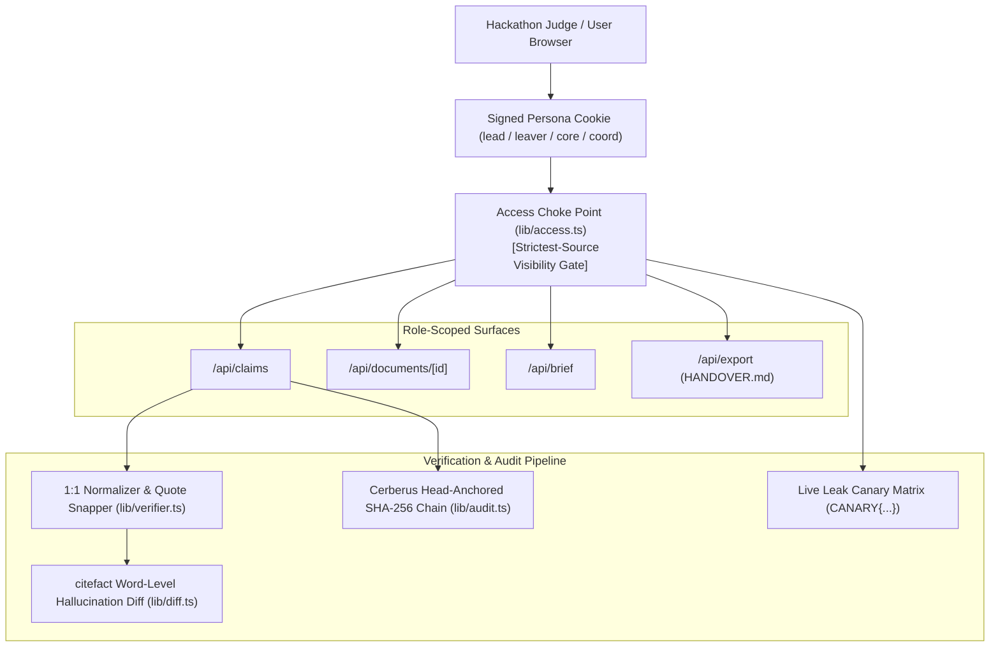

# Handover Ledger 📜

> **Evidence-Linked, Zero-Hallucination, Role-Scoped Knowledge Transition Platform**  
> *Built for HackWithPune / We Code Coders — CodeFrontier 2025*

[](https://nextjs.org/)
[](https://www.typescriptlang.org/)
[](https://vitest.dev/)
[](https://github.com/PanavCodes/Handover-Ledger)
[](https://github.com/PanavCodes/Handover-Ledger)

---

## Quickstart for Hackathon Judges (3 Steps)

Evaluate the full end-to-end handover workflow locally in under 60 seconds with **zero logins or API keys required**:

```bash
# 1. Install dependencies (inside apps/web)
cd apps/web && npm install --legacy-peer-deps

# 2. Run automated test suite (5 suites, 28/28 tests pass)
npm test

# 3. Start production build or development server
npm run build && npm run start
```
Open **`http://localhost:3000/demo`** in an incognito browser window to switch seamlessly across all 4 demo personas in one click.

*(See [docs/Handover-Ledger-Round2-Report.pdf](docs/Handover-Ledger-Round2-Report.pdf) for our complete Round 2 Technical Report with verified screenshots, test metrics, and architecture diagrams.)*

---

## 💡 The Problem & The Core Promise

When a critical engineer or project owner departs, institutional tacit knowledge evaporates:
- Unwritten architectural decisions are lost.
- Fragile crons, undocumented flashing procedures, and single points of failure remain hidden until production outages strike.
- Standard LLM summaries hallucinate quotes, merge contradictory statements, and leak confidential credentials across organizational boundaries.

**Handover Ledger** solves this with four non-negotiable guarantees:
1. **No Claim Without Evidence:** Every claim cites an exact verbatim quote string-matched against the source document with 1:1 character start/end offsets (`[chars 120..245]`).
2. **Restricted Means Absent:** A single access choke point (`lib/access.ts`) applies the strictest-source rule. Unauthorized personas receive zero synthetic leaks in API payloads, LLM contexts, or DOM elements.
3. **Contradictions Are Surfaced, Never Merged:** Opposing parameters (e.g. 115200 vs 57600 baud rate) trigger prominent conflict alerts for lead triage.
4. **Tamper-Evident Head-Anchored Audit Chain:** Every workspace action is committed to an append-only SHA-256 block ledger with external head anchors that detect both interior byte mutations and tail truncations.

---

## 🏛️ System Architecture



---

## 🌟 The 6 WOW Features

| # | Feature | Architectural Pattern | Judge Verification Path |
|---|---|---|---|
| **1** | **1:1 Evidence Lens Drawer** | `juricode-verifier` + `spancheck` | Click any claim in `/ledger` to inspect verbatim source spans in JetBrains Mono with exact offsets and view hallucination strike-through diffs. |
| **2** | **Live Leak Canary Matrix** | Invariant Canary Matrix | Open `/canary` and click **"Run Canary Sweep"** to execute 16 real-time penetration tests proving 0 leaks across all 4 personas. |
| **3** | **Bus-Factor Constellation** | `truckfactor` + `@xyflow/react` | Open `/constellation` and toggle **"Simulate Rahul's Departure"** to watch the Telemetry Pipeline pulse in red with a **Bus Factor = 0** orphan alert. |
| **4** | **Leaver Approval Gate** | `ServiceNow Now Assist` / `OakHive` | Open `/` as Rahul Mehta to review tacit claims and cryptographically seal the ledger before lead countersignature. |
| **5** | **Handover Readiness Dial** | Multi-Factor Composite Index | Open `/` to view the animated SVG score dial (0–100) breaking down citations, blockers, bus-factor risks, and sign-offs. |
| **6** | **Agent-Ready Export** | `claude-handoff` | Open `/brief` and click **"Agent Context (HANDOVER.md)"** to download a structured handoff document tailored for AI coding agents. |

---

## 📊 Benchmark Comparison

| Capability | OakHive | ServiceNow Assist | Cerberus / spancheck | **Handover Ledger** |
|---|:---:|:---:|:---:|:---:|
| Zero-Login Persona Simulation | ❌ | ❌ | ❌ | **✅ 4 Instant Roles** |
| Verbatim Character-Offset Highlighting | ❌ | ❌ | ⚠️ Library only | **✅ 1:1 In-App Evidence Lens** |
| Strictest-Source RLS Access Choke Point | ❌ | ⚠️ Role ACL | ❌ | **✅ Cryptographic Zero-Leakage** |
| Head-Anchored SHA-256 Audit Chain | ❌ | ❌ | ⚠️ Python only | **✅ Live Browser Inspector** |
| Bus-Factor Interactive Topology | ❌ | ❌ | ❌ | **✅ React Flow Constellation** |
| Word-Level Hallucination Strike-Through Diff | ❌ | ❌ | ⚠️ CLI only | **✅ citefact Visual Diff Tab** |
| AI Coding Agent Context Export (`HANDOVER.md`) | ❌ | ❌ | ❌ | **✅ Built-in Native Export** |

---

## Automated Test Verification

Our automated test suite runs under Vitest and validates verification, secrecy containment, cryptographic audit integrity, and end-to-end Round 2 workflow invariants:

```bash
$ npm test

 ✓ src/tests/verifier.test.ts (8 tests)
 ✓ src/tests/audit.test.ts (3 tests)
 ✓ src/tests/canary.test.ts (5 tests)
 ✓ src/tests/api-integration.test.ts (7 tests)
 ✓ src/tests/workflow-e2e.test.ts (5 tests)

 Test Files  5 passed (5)
      Tests  28 passed (28)
```

1. **`verifier.test.ts` (8 tests)**: 1:1 whitespace index map, verbatim quote snapping, secret regex scrubbing (`sk-`, `ghp_`, `AKIA`, PEM), and word-level rejection diff generation.
2. **`audit.test.ts` (3 tests)**: SHA-256 block hashing, interior payload tampering detection, and tail-truncation detection via external head anchors.
3. **`canary.test.ts` (5 tests)**: Confirms `CANARY-...` tokens in restricted and confidential sources never leak to unauthorized personas across 16 matrix checks (`4 personas × 4 surfaces`).
4. **`api-integration.test.ts` (7 tests)**: Role-scoped claim filtering, document 403 isolation, planted conflict preservation, roadmap scoping, and clean demo state reset.
5. **`workflow-e2e.test.ts` (5 tests)**: Prompt-injection immunity + general extraction, Gap-Driven Exit Interview closure superseding `missing` claims, deterministic cross-document conflict detection, cryptographic leaver/successor acknowledgements, and role-scoped rejection filtering.

---

## Demo Personas Available at `/demo`

- **Dr. Meera Iyer (Project Lead & Faculty Advisor)**: Unrestricted access across all 3 sensitivity tiers (`team`, `restricted`, `confidential`). Approves/edits claims, triages conflicts, previews role scopes (`View-As`), and verifies the SHA-256 audit chain.
- **Rahul Mehta (Departing Owner — Firmware & RF)**: Captures tacit notes, uploads labeled docs (enforced by HTTP 422 guard), answers Gap-Driven Exit Interview prompts at `/interview`, and signs the Leaver Attestation approval gate.
- **Ananya Rao (Successor — Core Dev)**: Technical successor receiving engineering decisions, CANbus/STM32 procedures, and the Core Dev 30-day transition plan, plus Formal Successor Receipt signing. Coordinator financials and confidential faculty notes are omitted server-side.
- **Kabir Shah (Operations Coordinator)**: Operations successor inheriting AeroTech sponsor milestones, ServoWorks vendor contacts, and logistics schedules, plus Formal Successor Receipt signing. Core Dev restricted hardware notes and faculty grant accounts are omitted server-side.

---

## Round 2 Summary & Roadmap

1. **Working Project Entry:** `/demo` (Zero-login instant 4-persona evaluation + `/interview`, `/capture`, `/ledger`, `/brief`, `/constellation`, `/canary`, `/audit`).
2. **Source Repository:** Public Next.js 14 full-stack app in `apps/web/`, Supabase RLS schema in `supabase/migrations/0001_init.sql`, updated Round 2 report in `docs/Handover-Ledger-Round2-Report.pdf`, and 28 Vitest tests in `apps/web/src/tests/`.
3. **Completed Functional Workflow:** Source ingest with mandatory fail-closed labeling (`HTTP 422`), live GitHub repo & commit ownership sync, 1:1 Evidence Lens + hallucination/secret guard diffing, Gap-Driven Exit Interview loop (`/interview`), cross-document contradiction resolution + revision history (`v1..vN`), 16-check Leak Canary matrix, head-anchored SHA-256 audit ledger, Leaver & Successor cryptographic sign-off receipts, and role-scoped `HANDOVER.md` / Markdown / JSON exports.
4. **Architecture Changes vs. Round 1 Blueprint:** Consolidated the planned FastAPI + Render workers into Next.js 14 serverless route handlers with batched extraction and an offline deterministic extractor alongside Claude Sonnet 4.5 tool use, eliminated login barriers via HMAC-signed demo persona cookies + `lib/access.ts`, and pulled forward the Exit Interview, conflict detector, multi-role Leak Canary, and cryptographic acknowledgements ahead of schedule.
5. **Round 3 Roadmap:**
   - Production Supabase Auth / SSO replacing demo cookies with dual-connection Postgres RLS (`db_user` / `db_admin`) and `pgvector` retrieval.
   - Continuous passive capture connectors (Slack, Jira/Linear, GitHub webhooks) recording tacit decisions as work happens.
   - Multi-hop LLM contradiction synthesis across >3 sources and OCR-aware PII/secret redaction across uploaded PDFs and binaries.

---

*Handover Ledger — Making Tacit Institutional Knowledge Machine-Verifiable and Cryptographically Evident.*

