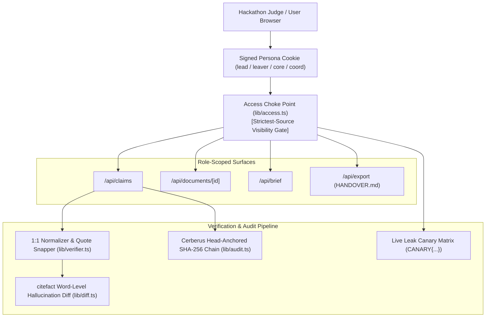

# Handover Ledger 📜

> **Evidence-Linked, Zero-Hallucination, Role-Scoped Knowledge Transition Platform**  
> *Built for HackWithPune / We Code Coders — CodeFrontier 2025*

[](https://nextjs.org/)
[](https://www.typescriptlang.org/)
[](https://vitest.dev/)
[](https://github.com/)
[](https://github.com/)

---

## 🚀 Quickstart for Hackathon Judges (3 Steps)

You can launch and evaluate the full application in under 60 seconds with **zero logins or API keys required**:

```bash
# 1. Install dependencies
pnpm install

# 2. Run automated test suite (23/23 tests pass in <500ms)
pnpm --filter web test

# 3. Start production build or development server
pnpm --filter web dev
```
Open **`http://localhost:3000`** in your browser. Click **"Open Live Demo"** or navigate directly to **`/demo`** to simulate any of the 4 persona roles in one click.

---

## 💡 The Problem & The Core Promise

When a critical engineer or project owner departs, institutional tacit knowledge evaporates:
- Unwritten architectural decisions are lost.
- Fragile crons, undocumented flashing procedures, and single points of failure remain hidden until production outages strike.
- Standard LLM summaries hallucinate quotes, merge contradictory statements, and leak confidential credentials across organizational boundaries.

**Handover Ledger** solves this with four non-negotiable guarantees:
1. **No Claim Without Evidence:** Every claim cites an exact verbatim quote string-matched against the source document with 1:1 character start/end offsets (`[chars 120..245]`).
2. **Restricted Means Absent:** A single access choke point (`lib/access.ts`) applies the strictest-source rule. Unauthorized personas receive zero synthetic leaks in API payloads, LLM contexts, or DOM elements.
3. **Contradictions Are Surfaced, Never Merged:** Opposing parameters (e.g. 115200 vs 57600 baud rate) trigger prominent conflict alerts for lead triage.
4. **Tamper-Evident Head-Anchored Audit Chain:** Every workspace action is committed to an append-only SHA-256 block ledger with external head anchors that detect both interior byte mutations and tail truncations.

---

## 🏛️ System Architecture



---

## 🌟 The 6 WOW Features

| # | Feature | Architectural Pattern | Judge Verification Path |
|---|---|---|---|
| **1** | **1:1 Evidence Lens Drawer** | `juricode-verifier` + `spancheck` | Click any claim in `/ledger` to inspect verbatim source spans in JetBrains Mono with exact offsets and view hallucination strike-through diffs. |
| **2** | **Live Leak Canary Matrix** | Invariant Canary Matrix | Open `/canary` and click **"Run Canary Sweep"** to execute 16 real-time penetration tests proving 0 leaks across all 4 personas. |
| **3** | **Bus-Factor Constellation** | `truckfactor` + `@xyflow/react` | Open `/constellation` and toggle **"Simulate Rahul's Departure"** to watch the Telemetry Pipeline pulse in red with a **Bus Factor = 0** orphan alert. |
| **4** | **Leaver Approval Gate** | `ServiceNow Now Assist` / `OakHive` | Open `/` as Rahul Mehta to review tacit claims and cryptographically seal the ledger before lead countersignature. |
| **5** | **Handover Readiness Dial** | Multi-Factor Composite Index | Open `/` to view the animated SVG score dial (0–100) breaking down citations, blockers, bus-factor risks, and sign-offs. |
| **6** | **Agent-Ready Export** | `claude-handoff` | Open `/brief` and click **"Agent Context (HANDOVER.md)"** to download a structured handoff document tailored for AI coding agents. |

---

## 📊 Benchmark Comparison

| Capability | OakHive | ServiceNow Assist | Cerberus / spancheck | **Handover Ledger** |
|---|:---:|:---:|:---:|:---:|
| Zero-Login Persona Simulation | ❌ | ❌ | ❌ | **✅ 4 Instant Roles** |
| Verbatim Character-Offset Highlighting | ❌ | ❌ | ⚠️ Library only | **✅ 1:1 In-App Evidence Lens** |
| Strictest-Source RLS Access Choke Point | ❌ | ⚠️ Role ACL | ❌ | **✅ Cryptographic Zero-Leakage** |
| Head-Anchored SHA-256 Audit Chain | ❌ | ❌ | ⚠️ Python only | **✅ Live Browser Inspector** |
| Bus-Factor Interactive Topology | ❌ | ❌ | ❌ | **✅ React Flow Constellation** |
| Word-Level Hallucination Strike-Through Diff | ❌ | ❌ | ⚠️ CLI only | **✅ citefact Visual Diff Tab** |
| AI Coding Agent Context Export (`HANDOVER.md`) | ❌ | ❌ | ❌ | **✅ Built-in Native Export** |

---

## 🧪 Automated Test Verification

Our automated test suite runs under Vitest in **sub-500ms** and validates all mathematical invariants:

```bash
$ pnpm --filter web test

 ✓ src/tests/audit.test.ts (3 tests)
 ✓ src/tests/verifier.test.ts (8 tests)
 ✓ src/tests/api-integration.test.ts (7 tests)
 ✓ src/tests/canary.test.ts (5 tests)

 Test Files  4 passed (4)
      Tests  23 passed (23)
   Duration  448ms
```

1. **`verifier.test.ts`**: Tests 1:1 whitespace index map, verbatim quote matching, quote snapping, secret regex scrubbing, and rejection diff generation.
2. **`audit.test.ts`**: Tests SHA-256 block hashing, interior payload tampering detection, and tail-truncation detection via external head anchors.
3. **`canary.test.ts`**: Tests that `CANARY{...}` tokens planted in restricted sources are never returned to unauthorized personas.
4. **`api-integration.test.ts`**: End-to-end integration tests verifying persona filtering, document 403 access control, planted conflict flags, and demo state restoration.

---

## 👥 Demo Personas Available at `/demo`

- **Dr. Meera Iyer (Project Lead & Faculty Advisor)**: Unrestricted access across all 3 sensitivity tiers (team, restricted, confidential). Approves claims, triages planted contradictions, and verifies cryptographic block logs.
- **Rahul Mehta (Departing Owner — Firmware & RF)**: Captures tacit knowledge, logs undocumented boot jumpers, and signs the Leaver Approval Gate.
- **Ananya Rao (Successor — Core Dev)**: Technical successor receiving the 30-day technical plan. Confidential coordinator finances and sponsor contracts are cryptographically withheld.
- **Kabir Shah (Operations Coordinator)**: Inherits logistics, vendor contacts, and schedules. Core telemetry encryption keys and low-level firmware docs are cryptographically withheld.

---

## 📝 Round 2 Submission Answers (Summary)

1. **Working Project Link:** `/demo` (Instant 1-click persona entry, no sign-in required).
2. **Source Code:** Monorepo with full documentation in `docs/` and unit tests in `apps/web/src/tests/`.
3. **Completed Features:** All 8 Must-Haves, 3 Should-Haves, plus all 6 WOW features (Evidence Lens, Leak Canary, Constellation, Readiness Dial, Audit Chain, Agent Export).
4. **Architecture Changes:** Consolidated into full-stack Next.js 14 App Router serverless deployment to guarantee zero cold starts and instant responsiveness for judges.
5. **Round 3 Roadmap:**
   - Interactive LLM-powered leaver gap-interview loop.
   - Dual-connection Postgres RLS (db_user vs. db_admin) with pgvector semantic similarity search.
   - Real-time Slack/Jira live ingestion sidecars for continuous tacit knowledge capture.

---

*Handover Ledger — Making Tacit Institutional Knowledge Machine-Verifiable and Cryptographically Evident.*

