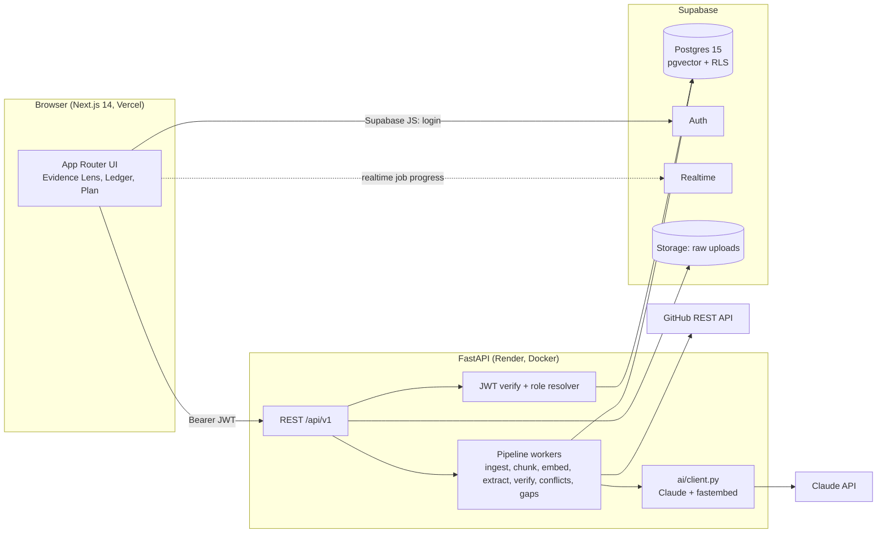
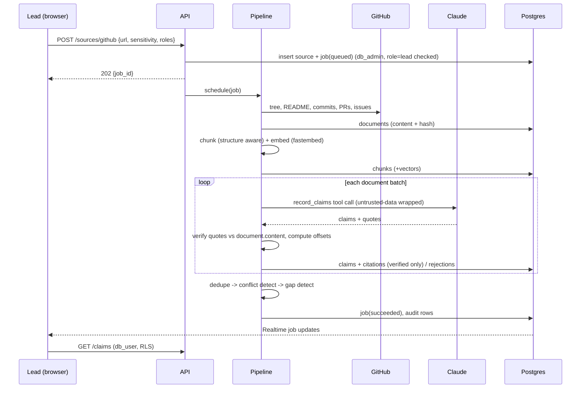

# 02. Architecture

## 1. System overview


## 2. Two database paths (the security core)
```
READ  path:  request -> verify JWT -> db_user():  SET LOCAL ROLE authenticated + request.jwt.claims -> RLS filters rows
WRITE path:  request -> verify JWT -> explicit role check in code -> db_admin(): postgres role (bypass RLS) -> insert/update + audit row
```
- Reads that feed a user's screen, an export, or an LLM prompt **always** use `db_user`. That guarantees "filter before retrieval/inference".
- The pipeline needs to write derived rows (documents, chunks, claims) regardless of the uploader's visibility, so it uses `db_admin`, but only after the API has verified the actor's role on the project and source.
- Ask-the-Ledger, export, graph, plan and claim list endpoints use `db_user` exclusively.

## 3. End-to-end data flow (Round 2 path)


## 4. Modules
### apps/api/app
```
main.py                 app factory, CORS, error handlers, routers
config.py               pydantic-settings (env)
deps.py                 get_current_user, require_role, db_user, db_admin
db.py                   psycopg pool, context helpers
models/                 pydantic schemas (request/response) + enums
routers/                projects, members, sources, jobs, claims, conflicts,
                        interview, ask, releases, insights, audit, admin, health
services/
  access.py             role/scope helpers, preview-as
  audit.py              append_audit()
  ingest/               github.py, uploads.py, normalize.py, chunker.py
  pipeline.py           orchestrates stages, job progress
  claims.py             CRUD, versioning, approve/reject
  verifier.py           quote normalisation + offset mapping
  conflicts.py          deterministic + LLM-assisted conflicts
  gaps.py               gap rules -> interview questions
  roadmap.py            plan generation + validation
  readiness.py          score formula
  graph.py              constellation nodes/edges
  receipts.py           canonical JSON, SHA-256, Ed25519 signature
  canary.py             leak canary runner
ai/
  client.py             Anthropic wrapper (retry, cache, logging, budget)
  prompts.py            system prompts (versioned constants)
  schemas.py            tool JSON schemas
  embeddings.py         fastembed singleton
tests/                  unit, integration (real Postgres), canary, eval
```

### apps/web/src
```
app/                    routes (see docs/09)
components/ui/          shadcn primitives
components/ledger/      ClaimCard, StatusBadge, ConfidenceMeter, EvidenceLens, ...
components/shell/       Sidebar, Topbar, CommandPalette, RoleSwitcher
components/graph/       Constellation
lib/supabase/           browser + server clients
lib/api/                typed openapi-fetch client + generated schema.d.ts
lib/hooks/              useJobProgress, useHotkeys, ...
styles/                 globals.css (tokens)
```

## 4.1 Key design decisions
| Decision | Rationale |
|---|---|
| Postgres RLS as the boundary | UI/API bugs cannot leak rows the DB will not return |
| Reads via RLS, writes via audited admin path | Simple mental model; fewer policies to get wrong |
| Documents store full canonical text; citations store offsets | Verification and highlighting are deterministic |
| Claims carry `subject_key` + `assertion_value` | Enables rule-based conflict detection without trusting an LLM |
| Jobs table + Realtime | Progress UI without websockets code; resumable pipeline |
| Tool-use structured output | Schema-conformant JSON; one tool = one output shape |
| fastembed (CPU, ONNX) | Free, no extra API key, 384-d, fast enough for small corpora |
| Exact vector scan at demo scale | RLS + approximate indexes can drop results; exact scan is correct and fast for < 50k chunks |

## 5. Environments
| Env | Web | API | DB/Auth |
|---|---|---|---|
| local | `localhost:3000` | `localhost:8000` | Supabase CLI (Docker) or a dev cloud project |
| prod | Vercel | Render | Supabase cloud (region ap-south-1 Mumbai recommended) |

## 6. Cross-cutting concerns
- **Observability:** structlog JSON logs with `request_id`, `user_id`, `project_id`; pipeline stage timings; token usage per call stored in `llm_calls`.
- **Idempotency:** documents keyed by `(source_id, path, content_hash)`; re-ingest skips unchanged docs; extraction keyed by `(document_id, content_hash, prompt_version)`.
- **Failure handling:** every stage catches, records `jobs.error`, and leaves previous good data intact. Retries with exponential backoff on 429/5xx.
- **Privacy:** only synthetic or sanitized data in demos; raw uploads in a private bucket; signed URLs only for the owner roles.
